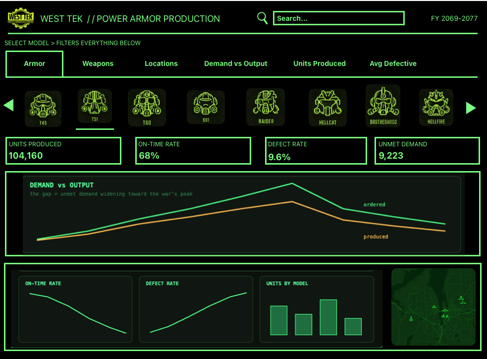
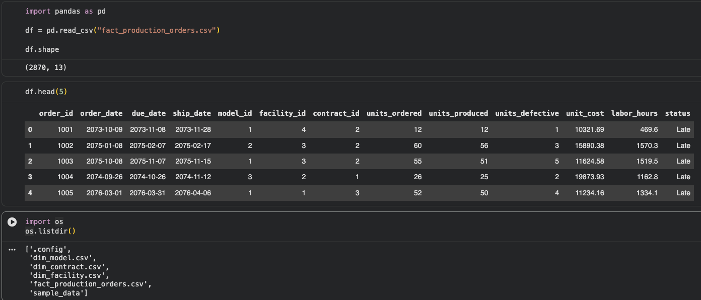
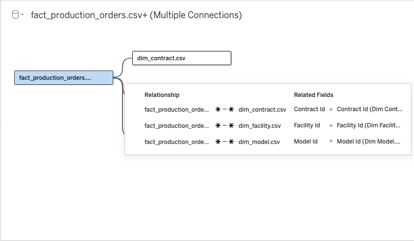
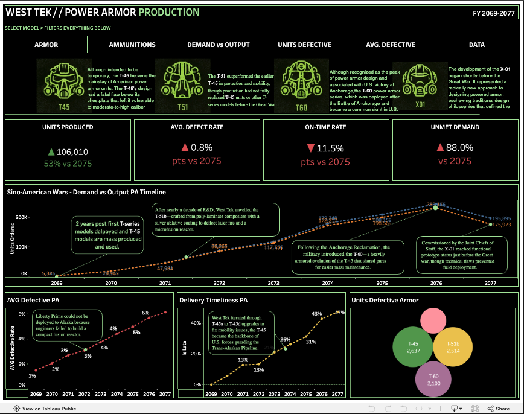
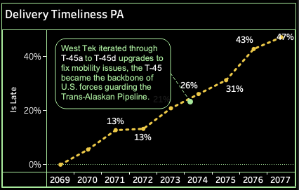

# WEST TEK // Power Armor & Munitions Production

> Interactive Tableau BI dashboard for a fictional Fallout defense contractor — built end to end, from the data to the design.
>
> **▶ [View live on Tableau Public](https://public.tableau.com/app/profile/tevin.barnes/viz/WestTek/DashboardPA)**

## Overview

I created this project to represent a real-world ask of ordered and produced company units over a set yearly timeline.

## Process

Communication was received from leadership on a real-world ask. A request form was filled out and notes were taken of critical and superficial additions to the final project with department leaders. I reached out and received the necessary data from departments to begin creating data tables.

Once confirmed, I created a mock of the dashboard for the desired layout and colors for the report. I completed a prototype report using Freeform and custom image visuals and icons.

After finalizing the mock, I began to explore the received data CSV files using pandas via Google Colab, and used this as an opportunity to find outliers or possible inconsistencies with the data.

Then I proceeded to Tableau, imported the CSV text files, and created relationships between the tables with their respective IDs.

Then I proceeded to build the dashboard using the mock prototype that was initially made. Horizontal containers and measures were primarily used to construct all visual aspects. Navigation between various pages to explore the data set visually was added based on two categories: Power Armor and Ammunitions. Each has its own respective data relation per model and associated category.

Additional data points such as defective count and rate, and delivery and output properties, were also included for deeper insights. A line chart with Milestone flags helps drive the story of the sudden increase in output vs. demand via real-world events and impact. Brief descriptions and unit importance are added to help the user understand the purpose and impact that could have resulted from the use of each model.

## Tools & Skills

- **Tableau** — dashboards, calculated fields, filter actions, page navigation, custom shapes/icons
- **Python / pandas (Google Colab)** — data exploration and QA
- **Data modeling** — star schema (fact table + dimension relationships on IDs)
- Dashboard design, conditional formatting, and data storytelling

**▶ [View the live dashboard on Tableau Public](https://public.tableau.com/app/profile/tevin.barnes/viz/WestTek/DashboardPA)**
